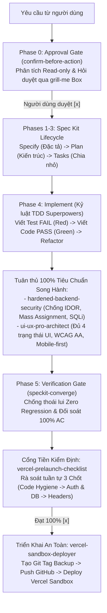

# Antigravity Rules & Skills Ecosystem 🛡️🚀

Bộ cấu hình tiêu chuẩn tối thượng dành cho trợ lý lập trình **Antigravity AI (Google DeepMind)**. Kho lưu trữ này chứa toàn bộ các **Quy tắc bắt buộc (Rules)** và **Kỹ năng chuyên sâu (Skills)** nhằm biến Agent thành một kỹ sư phần mềm cao cấp, tuân thủ kỷ luật kỹ thuật nghiêm ngặt, bảo mật đa tầng và không bao giờ viết code cẩu thả.

---

## 🏗️ 1. Sơ Đồ Kiến Trúc Luồng Vận Hành (End-to-End Pipeline)

Mọi yêu cầu lập trình đi qua hệ sinh thái này đều được kiểm soát chặt chẽ qua chuỗi 6 giai đoạn:



---

## 📜 2. Danh Mục 9 Bộ Quy Tắc Cốt Lõi (`rules/`)

| Quy tắc (Rule File) | Vai trò & Kỷ luật thực thi |
| :--- | :--- |
| **`confirm-before-action.md`** | **Phase 0: Approval Gate** — Cấm tự ý sửa code/tạo file bừa bãi. Bắt buộc hiển thị hộp trắc nghiệm tương tác `ask_question` (`grill-me`) để thống nhất giải pháp và xin duyệt trước. |
| **`speckit-enforcer.md`** | **Phases 1-5: Spec Kit + Superpowers TDD** — Chu trình phát triển chuẩn: Đặc tả $\rightarrow$ Kiến trúc $\rightarrow$ Task 2-5 phút $\rightarrow$ Viết test trước (Red) rồi mới viết code (Green) $\rightarrow$ Nghiệm thu chống thoái lui. |
| **`hardened-backend-security.md`** | **Bảo mật Backend nghiêm ngặt** — Cấm shortcut/TODO. Validate Schema, chống Mass Assignment, triệt tiêu BOLA/IDOR bằng query-level scoping, bọc Transaction, DTO an toàn. |
| **`ui-ux-pro-architect.md`** | **Kiến trúc UI/UX chuyên nghiệp** — Bắt buộc đủ 4 trạng thái (*Loading*, *Empty*, *Error*, *Data*), chống double-submit, chuẩn khoảng cách bội số 4px/8px, WCAG AA, mobile-first a11y. |
| **`secret-leak-prevention.md`** | **Phòng chống rò rỉ Secret & PII** — Chặn file DB/Data (`.csv`, `.sql`, `.db`), quét sạch SĐT thật, CCCD/CMND, email cá nhân và token trước khi commit/push/deploy. |
| **`vercel-prelaunch-checklist.md`** | **Rà soát 3 Chốt kiểm định trước Deploy** — Kiểm soát Step-by-step Hard Stop: Chốt 1 (Code Hygiene) $\rightarrow$ Chốt 2 (Auth & Access) $\rightarrow$ Chốt 3 (Input, Upload, Rate limit, Headers). |
| **`vercel-sandbox-deployer.md`** | **Sao lưu GitHub & Deploy Sandbox** — Nguyên tắc *"No GitHub Backup = No Vercel Deploy"*. Bắt buộc đẩy Git Tag backup lên GitHub thành công trước khi deploy preview. |
| **`software-diagram-architect.md`** | **Kiến trúc & Vẽ biểu đồ phần mềm** — Tự động phân tích code thật để vẽ Use Case, Sequence, ERD, Class, Flowchart xuất chuẩn Markdown, PlantUML, Draw.io và Desktop. |
| **`memory-bank.md`** | **Bộ nhớ phiên làm việc lâu dài** — Quản trị trạng thái qua `.antigravity/` (`activeContext.md`, `progress.md`), chống full-scan lãng phí context token. |

---

## 🛠️ 3. Danh Mục 7 Kỹ Năng Chuyên Sâu (`skills/`)

1. **`grill-me`**: Phỏng vấn làm rõ yêu cầu, đánh giá trade-off kỹ thuật và phê duyệt kế hoạch qua hộp câu hỏi trắc nghiệm tương tác `ask_question`.
2. **`hardened-backend-security`**: Bộ tiêu chuẩn triển khai backend chống lỗ hổng OWASP Top 10, phòng chống Injection, kiểm soát truy cập và giao dịch nguyên tử.
3. **`ui-ux-pro-architect`**: Thiết kế giao diện và component tương tác cao cấp, thân thiện và tuân thủ Design System.
4. **`secret-leak-prevention`**: Công cụ quét và cảnh báo rò rỉ thông tin định danh cá nhân và khóa bí mật.
5. **`software-diagram-architect`**: Kỹ năng chuyên gia vẽ biểu đồ chuẩn học thuật và kỹ thuật từ source code thực tế.
6. **`vercel-prelaunch-checklist`**: Kịch bản kiểm tra chất lượng và an ninh 3 giai đoạn dành riêng cho các ứng dụng chạy trên Vercel.
7. **`vercel-sandbox-deployer`**: Tự động hóa kiểm thử cục bộ, sao lưu Git tag và deploy lên Vercel Preview Sandbox kèm hỗ trợ rollback tức thì.

---

## 🚀 4. Hướng Dẫn Cài Đặt / Đồng Bộ Vào Máy Mới

Để áp dụng toàn bộ hệ sinh thái này trên máy tính của bạn:

```bash
# 1. Clone repository về máy
git clone https://github.com/haimtts03134-del/antigravity.git ~/.gemini/antigravity-hub

# 2. Đồng bộ Rules vào thư mục cấu hình toàn cục của Antigravity
cp -r ~/.gemini/antigravity-hub/rules/* ~/.gemini/config/rules/

# 3. Đồng bộ Skills vào thư mục kỹ năng toàn cục
cp -r ~/.gemini/antigravity-hub/skills/* ~/.gemini/config/skills/

# 4. Sao chép file chỉ thị toàn cục AGENTS.md
cp ~/.gemini/antigravity-hub/AGENTS.md ~/.gemini/AGENTS.md
```

Khởi động lại **Antigravity IDE**, toàn bộ hệ sinh thái bảo mật và chất lượng code sẽ tự động có hiệu lực ngay lập tức!
